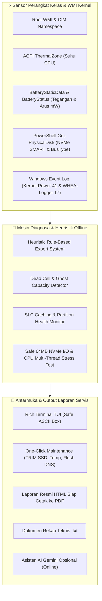

# 🛠️ MSB Hardware Diagnostic Tool (Titan Edition)

<p align="center">
  
  
  
  
  
  
</p>

> **Portable Hardware Diagnostics, Deep Battery BMS Inspector, NVMe/CPU Benchmarking, & Field Service Reporting Tool for IT Technicians**  
> Dirancang dan dikembangkan langsung dari pengalaman teknisi servis lapangan (**MSB Computer & Network Solutions**) untuk mendiagnosa kerusakan laptop dan PC klien secara akurat hingga level sirkuit daya dan sensor kernel tanpa ketergantungan software pihak ketiga berbayar.

---

## 🏛️ Arsitektur Sistem & Alur Diagnostik



---

## 🔬 Sorotan Fitur Unggulan

### 1. 🔋 Deteksi Kritis Baterai: Kasus *Dead Cell* & *Ghost Reading*
Masalah umum yang sering membingungkan pengguna dan teknisi pemula:  
> *"Laptop dicas berjam-jam persentase baterai stuck di 6% atau tidak naik. Begitu charger dicabut, laptop langsung mati total. Tapi di Windows / BatteryInfoView kapasitas terbaca 100% dan wear level 0%?"*

**Akar Masalah yang Dideteksi Tool Ini:**
- Nilai 100% tersebut adalah **Ghost Reading** (data statis EEPROM pabrik yang terkunci saat BMS mengalami *Safety Cutoff*).
- Tool ini menginterogasi controller ACPI tingkat rendah:
  1. **Arus Pengisian Nyata (*ChargeRate*)**: Jika charger tercolok namun arus masuk terbaca `0.0 Watt (0 mW)`, sirkuit pengisian telah diputus oleh MOSFET proteksi.
  2. **Tegangan Terminal (*Voltage*)**: Mendeteksi penurunan voltase sel lithium di bawah batas ambang operasional motherboard.
  3. **Vonis Pasti**: Membedakan secara tegas apakah masalah ada pada adapter charger, IC charging motherboard, atau sel baterai fisik yang mati (*Dead Cell*).

### 2. ⚡ Audit Uptime & Jebakan *Fast Startup*
- Fitur *Fast Startup* Windows secara default mengubah tombol "Shutdown" menjadi status *Hibernation Kernel*, menyebabkan RAM dan cache driver tidak pernah di-reset bersih hingga berminggu-minggu.
- Tool ini menghitung durasi boot sebenarnya dan mendeteksi kapan sistem membutuhkan restart kernel murni.

### 3. 💽 Audit Kesehatan SSD NVMe & *Dynamic SLC Caching*
- Memindai status S.M.A.R.T., tipe antarmuka bus (NVMe vs SATA), dan kapasitas partisi.
- Mengingatkan teknisi jika partisi C: tersisa di bawah 15-20% (ambang kritis di mana SSD tipe TLC/QLC kehilangan ruang *Dynamic SLC Cache*, yang menyebabkan kecepatan tulis anjlok drastis dan mempercepat degradasi memori NAND).

### 4. 🚨 Deteksi Log Crash Tersembunyi (7 Hari Terakhir)
- Memindai Windows Event Viewer untuk mendeteksi:
  - **Kernel-Power (Event ID 41)**: Riwayat mati mendadak, drop tegangan power supply, atau mati paksa.
  - **WHEA-Logger (Event ID 17)**: Koreksi otomatis bus PCIe / bus prosesor AMD Zen atau Intel Core.
  - **Disk / StorNVMe Timeout**: Indikasi awal SSD/HDD mulai mengalami bad sector atau error kontroler.

### 5. 📊 Ekspor Laporan Resmi HTML & TXT
- Menghasilkan file laporan berformat HTML modern (`Laporan_Hardware_[NamaLaptop]_[Timestamp].html`) yang langsung siap dicetak menjadi PDF untuk dilampirkan ke klien sebagai **Lembar Hasil Diagnosa Resmi MSB Solutions**.

---

## 🖥️ Antarmuka Menu Interaktif (TUI)

```text
+----------------------------------------------------------------------+
|     PORTABLE HARDWARE DIAGNOSTIC TOOL (ENTERPRISE TITAN EDITION)     |
|   AIDA64 / HWiNFO Class • Root WMI • Offline Heuristic Engine        |
+----------------------------------------------------------------------+
| No | Modul Diagnostik / Fitur             | Keterangan               |
+----+--------------------------------------+--------------------------+
|  1 | Full Deep Hardware Audit             | Pindai seluruh sensor    |
|  2 | Deep Battery & Power Inspector       | Arus Watt & Dead Cell    |
|  3 | Audit Hardware Event Log             | BSOD & WHEA (7 hari)     |
|  4 | Hardware Benchmark Suite             | Speed NVMe & CPU Stress  |
|  5 | One-Click System Optimizer           | TRIM SSD & Clean Temp    |
|  6 | Ekspor Laporan HTML & TXT            | Cetak laporan servis     |
|  7 | Konsultasi AI Gemini Online          | Opini AI (Opsional)      |
|  0 | Keluar                               | Tutup aplikasi           |
+----+--------------------------------------+--------------------------+
```

---

## 🚀 Panduan Instalasi & Penggunaan

### Prasyarat
- **Sistem Operasi**: Windows 10 atau Windows 11 (64-bit)
- **Python**: v3.10 atau lebih baru (Disarankan dijalankan sebagai Administrator agar dapat mengakses WMI Root dan Event Viewer)

### 1. Kloning Repositori
```bash
git clone https://github.com/owensavala/hardware-diagnostic-tool.git
cd hardware-diagnostic-tool
```

### 2. Pasang Dependensi
```bash
pip install -r requirements.txt
```

### 3. Jalankan Pengujian Unit Otomatis
```bash
python test_hardware_diagnostic.py
```

### 4. Jalankan Aplikasi
```bash
python hardware_diagnostic.py
```

---

## 📦 Kompilasi ke File `.exe` Mandiri (Portable)

Teknisi dapat mengompilasi skrip ini menjadi satu file executable mandiri (`.exe`) berukuran ringan tanpa memerlukan instalasi Python di komputer target/klien:

```bash
# Jalankan skrip otomatis:
build_exe.bat

# Atau manual via terminal:
pip install pyinstaller
pyinstaller --noconfirm --onefile --console --name "HardwareDiagnosticTitan" hardware_diagnostic.py
```
File binary portable siap pakai akan otomatis terbentuk di direktori `dist/HardwareDiagnosticTitan.exe`. Cukup simpan di Flashdisk teknisi untuk dibawa ke lokasi servis.

---

## 👤 Pengembang

**Muh. Sattar Barakati (Owen)**  
- **Brand**: MSB Computer & Network Solutions  
- **Basis Operasi**: Kalumata, Kota Ternate, Maluku Utara (Layanan servis lintas pulau: Ternate, Bacan, Kayoa, Subaim)  
- **GitHub**: [@owensavala](https://github.com/owensavala)  
- **Portfolio**: [muhsattarbarakati.my.id](https://muhsattarbarakati.my.id)  

---

## 📄 Lisensi

Proyek ini dilisensikan di bawah [Lisensi MIT](LICENSE) - bebas digunakan oleh teknisi, pengembang, dan institusi servis komputer di seluruh dunia.
